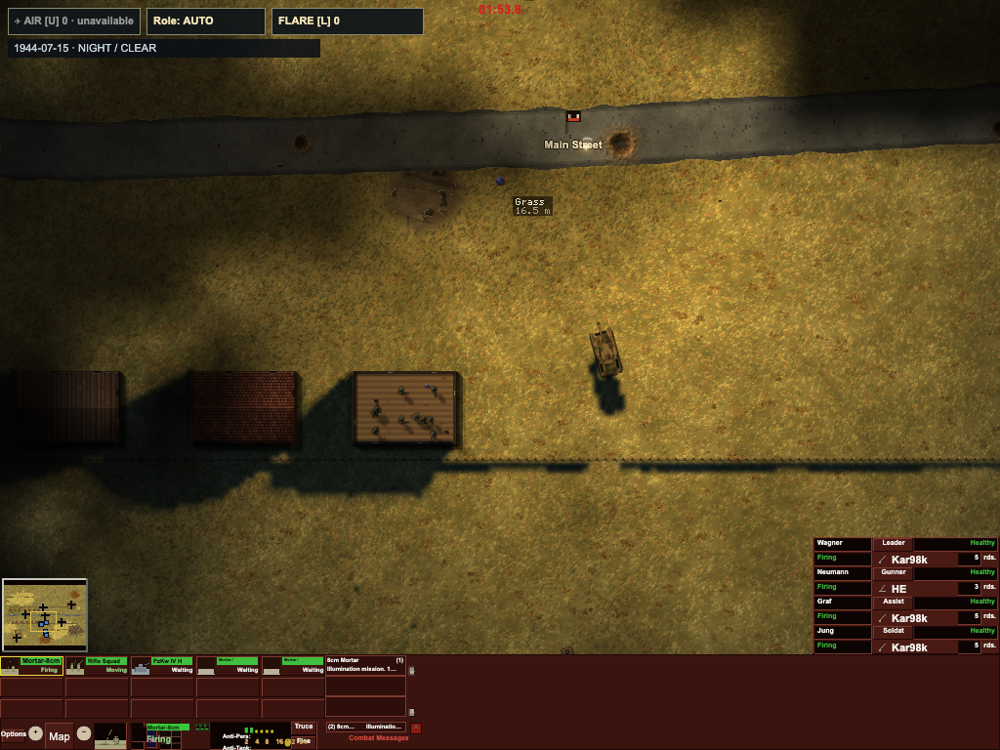
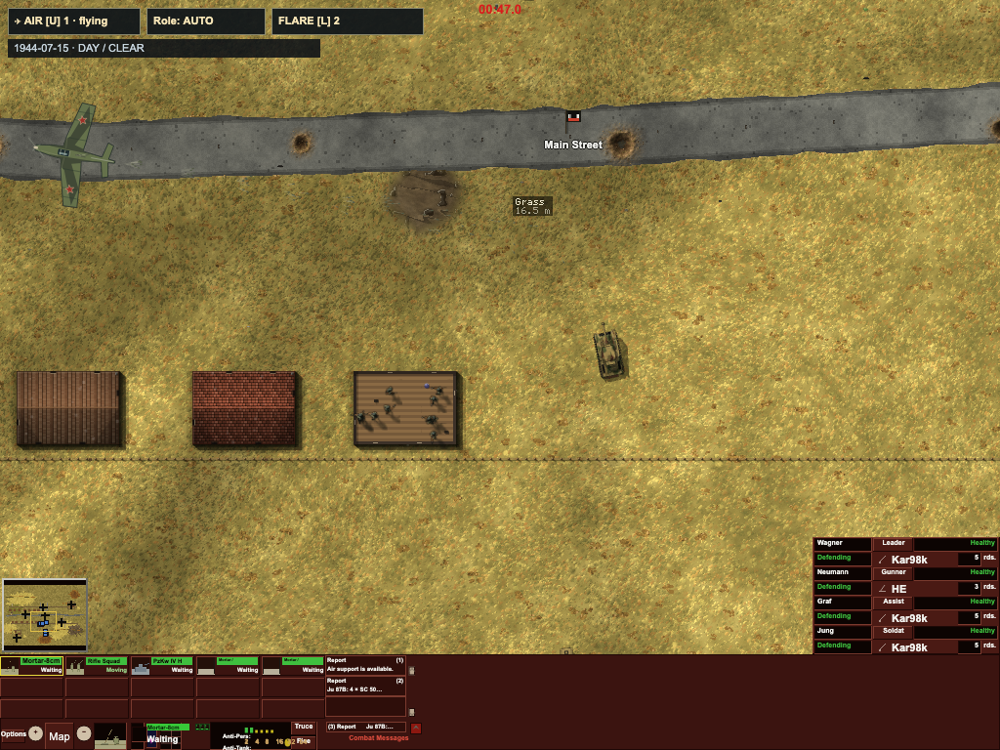

# 058–059 — air support and illuminated night combat

Implemented and verified 2026-11-02.
[Rules, controls and calibration](../../reference/plans/2026-11-02-air-night-implementation.md).
Simulation source SHA-256:
`c89888b6039cd98dfa3d87cc841533bd20818be04b597b9f46bd30dbebe9932f`.

## Actual gameplay recordings

These use production `Battle`/`BattleScreen` on `village_1942`, normal deployment,
readiness and support commands, both controllers human and enemy-reveal cheats
off. The harness holds the normal UI clock and advances two production ticks per
animation frame; recording speed/frame intervals are test cadence, not live FPS.
Visual fixtures enable Always Obey Orders / Never Act on Initiative to hold the
demonstration steady; ordinary refusal/hesitation is covered separately.

- [Mortar launch, descent and extinction](mortar-descent.webm): an actual finite
  round, laying/flight, parachute, high/mid/low light, lengthening terrain/building/
  hull shadows, wind drift and burnout. No fabricated flare. GPU 192 × 126,
  three emitter samples and 3D vehicles. `night-gameplay.json`.
- [Air-support passes](air-support.webm): UI AUTO Stuka call, Soviet PTAB area
  command, then UI ARMOUR Ju 87G call. Four SC 50, 192 PTAB and 24 cannon rounds
  release/resolve; each aircraft completes one pass and departs. No ordnance
  remains airborne. `air-gameplay.json`.
  This demonstration assigns two German passes to show both variants; normal
  default allocation remains one mission per battle.
- Full mortar lifecycle also passes with forced Canvas lighting and vehicle
  sprites, 40 × 26 / five exact emitter samples. `canvas-gameplay.json`.
- Real setup clicks choose night/weather/date, save/load and carry the preset
  into requisition. Two browser clients create/join a real relay room: both show
  night/rain/1944-02-29 and guest condition controls are disabled. `setup-ui.json`.
  The test relay explicitly allows only its loopback frontend origin.
- No page errors. All readers leave the hash/RNG unchanged; every browser script
  stops its own browser, relay and Vite server.




## Determinism and information

**All 1,700 per-tick hashes and full command replays match exactly** in M2 Node,
Chromium and WebKit: 400 daylight ticks include both completed support passes and
196 released ordnance; 1,300 night ticks include a real mortar round, descent and
extinction. Whole-result SHA-256:
`769900083d32a228074c2889a76c1d341316f9fe6d0888d44d109bd2528372db`.
`parity.json` and `node-trace.json` retain the summary and complete chain.

The entire chain also matches the pre-optimization implementation bit for bit.
CPU height bounds skip only provably empty samples, preserve remaining sample
coordinates/multiplication order and still test every physical hull. A short
60-tick-per-condition M5/M2 sample is byte-identical, SHA-256
`2be802f33b5e42245a573e8ccc6697e9921f3206b2290c32664a2fb6e49583be`;
`m5-m2-sample.json`. Long jobs ran on the user's Mac mini from isolated immutable
source/test/tool snapshots, without credentials or `.git`.

Tests distinguish private sightings from operational radio/HQ delivery, preserve
report age, drop payloads after reporter/radio/seat loss and prevent hidden target
tracking. Actual physical friendly/enemy hits, both sides' night sight, directional
lighting, roofs/trees/hulls, slopes/ridges, source overlap, stock, incapacity,
pause, cancellation and read-only queries are covered.

Independent review found a retargeting mortar-cycle bypass and ordinary fire's
corpse/completion logic cancelling illumination; both have regressions. The
additional radio audit and missing-config legacy observer fixture were corrected.
Final targeted review also closed an illumination-specific obedience bypass:
laying/launch now wait for each participating man's order acceptance and normal
crew eligibility, including first-fire shock, dodge and equipment handling.

## Rendering measurements

M2 Pro, Chromium, 1024 × 768 village with mortar/rifle/armour and carriers. The
render-only comparison holds actors fixed after a real mission and advances
display time 0.05 s per frame. It restores conditions/time and verifies the full
hash. One browser renders at a time; ordinary CPU regression work also ran.
These are complete `BattleScreen.draw` timings, not GPU timer queries or FPS
certification.

| Renderer | Day median / p95 | Lit night median / p95 |
|---|---:|---:|
| 3D vehicles + GPU mask | 54.7 / 56.3 ms | 31.0 / 33.4 ms |
| Sprites + Canvas mask | 3.2 / 4.4 ms | 0.9 / 20.3 ms |

Day uses existing 3D sun shadows; night replaces them with the common light pass.
Canvas updates at 5 Hz of simulation time, reusing its mask between updates.
Raw results: `render-benchmark-gpu.json`, `render-benchmark-canvas.json`.
The initial GPU lifecycle median was 134.4 ms; bounded resolution/emitter sampling
and cached readback reduced it to 33.1 ms in the final accelerated lifecycle.
Final Canvas lifecycle median/p95 is 22.9/52.1 ms when two simulation ticks advance
every frame. Cold compilation/video capture contribute to lifecycle maxima;
no cold-start latency guarantee is claimed.

## Verification and reproduction

Types and final production build pass; the existing large bundle warning remains.
**1953 passed, 2 existing skips across 213 ordinary test files**, a distinct-file
union in `validation.json`. Completed immutable ordinary snapshots are superseded
by final-source affected checks: **121 passed, one visibility skip, 13 files**.
This includes two real support lockstep/desync-repair cases: corrupt pilot RNG or
illumination stock, detect disagreement, rebuild normally, and continue to equal
post-repair hashes, physical impacts/descending light and final state. The
initial broad run was stopped in the legacy full-size 32-case lockstep soak;
that soak is not claimed complete here. All other files completed, including
the existing separate-process full replay checks. The full-map balance harness
remains opt-in (one of the existing skips). Prior 056 soak acceptance is retained
in its report; these features do not reopen general P2 performance acceptance.

```sh
npm run typecheck
npm run build
npx vitest run test/airSupport.test.ts test/illumination.test.ts test/nightLighting.test.ts test/airSupportProtocol.test.ts test/supportReplay.test.ts test/supportLockstep.test.ts test/battleSupportInput.test.ts test/campaignAirSupport.test.ts
npx esbuild tools/supportTraceNode.ts --bundle --platform=node --format=esm --outfile=/tmp/cc3-support-trace.mjs
node /tmp/cc3-support-trace.mjs node-trace.json
```

With Playwright installed (or `CC3_PLAYWRIGHT_MODULE` / `CC3_CHROMIUM_EXECUTABLE`
pointing at an existing installation), run sequentially from the checkout root:

```sh
node tools/supportSetupBrowserCheck.mjs
node tools/airSupportBrowserCheck.mjs
node tools/nightSupportBrowserCheck.mjs night
node tools/nightSupportBrowserCheck.mjs fallback
node tools/nightLightingBenchmark.mjs gpu
node tools/nightLightingBenchmark.mjs canvas
```

These scripts own ports 5198, 5200 or 5201 and stop services in `finally`. For
cross-engine traces start a caller-owned Vite on 5199, then run
`tools/supportTraceBrowser.mjs chromium chromium.json` and `webkit webkit.json`.
The trace script closes its browser and preserves the caller's server.

## Boundaries

This is bounded-resolution physical ray marching, not hardware ray tracing. CPU
sensing retains all sources/occluders; GPU display caps eight sources and 96 shown
hull/turret boxes. Canvas has visibly coarser/softer shadows. Height-field surface
shading approximates cutaway interiors. Aircraft are procedural animated Canvas
art. Timings, dispersion, damage, radio equipment and daily allocations are
documented gameplay calibration; no aerodynamic/clinical validation is claimed.
General P2 optimization, fighter/flak systems and JEV remain separate. Ruleset:
`air-support-night-1`; older builds are not promised identical replays and online
fingerprints reject incompatible peers. Public relay hosting and Internet/Safari/
Firefox online soak remain the earlier user deployment acceptance steps.
