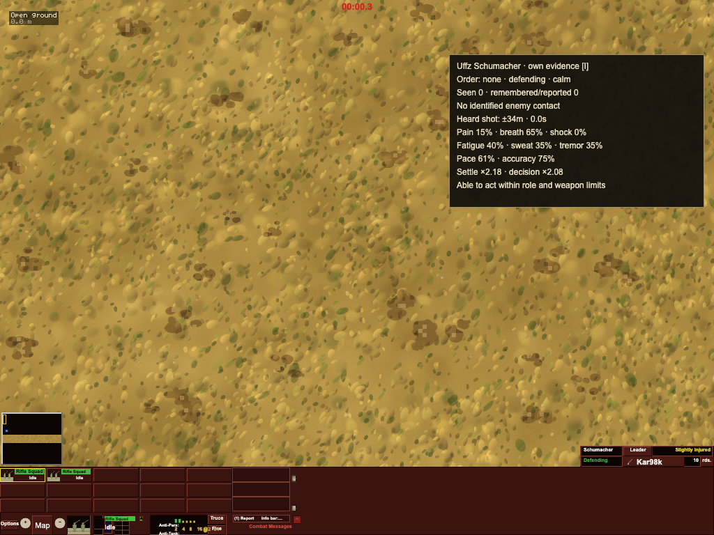

# 056 evidence — individual perception and human capability

Status: implemented and verified, 2026-11-02.
Specification: `../../specs/2026-11-01-personal-evidence-and-capability.md`.
Simulation source SHA-256: `700448133ee2f447354381e02812b231cf1dd54207f1ca40fa589a4c1518a858`.

Every person, including seated and weapon crews, uses their own immutable visual
observations, uncertain hearing, delivered voice/intercom/radio reports, orders
and capability. Precision fire requires personal sight; reports retain their
source and age. Casualty/leadership/objective/navigation awareness and indirect
observation travel through eligible surviving channels. Hidden live enemy state,
side-spotted display sets and the camera do not supply individual decisions.

Breath, sweat, hearing loss, pain bouts and acute shock combine with existing
wounds, fatigue, stress, disposition and experience. One condition integrator
owns fatigue. Common capability affects pace, sensing, aim/settling/dispersion,
work, driving, loaded weapons and decision/obedience latency. Personal random
streams and all future-affecting queues/private human state are canonical.

Predictive routes/cover use immutable briefing plus personal geometry/hull
observations. Actual collision, support and damage remain physical operations.
A bump gives one revisable anonymous local footprint, expires after 10 s, and
cannot disclose hidden identity or unrelated terrain. Reached-corner traffic
uses its own canonical wait/replan timer, preserving terrain/profile vetoes and
the next player waypoint. The formerly stuck real-map drive reaches all 10 goals.
Existing wreck illumination extends visibility only through actual light/eye LOS;
a damaged engine cannot identify a hull through a ridge.

## Verification

- **1919 passed, 2 skipped across 206 files**, all from the same
  immutable final source. Full non-lockstep regression: 1887
  passed; full network/lockstep/recovery: 32 passed.
  File-level results: `validation.json`.
- Types and production build pass. The existing large JavaScript chunk warning
  remains; no bundle-size or overall FPS acceptance is claimed.
- Network coverage includes two peers playing 10 simulation minutes over a laggy,
  reordering link with identical hash chains; command timing, loss, repair of RNG,
  state and command corruption, 12 stress seeds, repeated recovery, hostile wire,
  failed rebuilds, final-state comparison and repeated hashes.
- Replay in a separate Node process matches the recorded per-tick chain exactly.
  Viewer-side comparisons cover human/human, human/AI and AI/AI. Hidden-state,
  separate personal knowledge, read-only readers and restoration are tested.
- Final 60-step M5 Node / M2 Node / Chromium / WebKit trace is byte-identical,
  including restoration after step 20. SHA-256
  `f9aca3e43f73cafb2f02d9ae9e408531bccc26dfe6e011be2c5e7dfdccc4d352`.
  This covers V8 and JavaScriptCore; `engines.json` records browser results.
- Real Chromium I-key opens the own-person inspector; no page errors; hash and
  RNG stay unchanged across input/render frames. Owned browsers/servers stopped.

Independent review covered the whole human migration, predictive navigation and
the final traffic fix. Corrected findings include live hidden aliases, loaded-crew
operation gates, report age, driver shortcuts, self obstacles, bump scope,
report starvation, remote MG-loss stress and unreported objective ownership.
Regression fixtures declare personal sight or deliver actual reports. The old
order-swap recovery fixture now swaps conflicting orders for the same team;
independent teams can legitimately commute with personal RNG.

## New-feature cost check

Navigation selects the retained 256 cells before copying geometry, batches memory
retention and gathers candidates once per observation pass. Hearing rejects
inaudible sounds before LOS and computes masking once per listener/pass. Report
dedup preserves its 512-key insertion-order bound without per-send enumeration.
A 20-pass dense-terrain comparison preserves all complete state hashes; Mini
median navigation acquisition 8.85825 ms → 1.887375 ms under the recorded concurrent
load (`navigation-benchmark.json`). This is a navigation microbenchmark, not an
FPS measurement or resumption of the deferred P2 performance project.

## Reproduction

Long runs used the user's own Mac mini, nice 19, one worker per batch. Inputs were
isolated immutable copies; unrelated jobs were preserved.

```sh
npx tsc --noEmit
npm run build
npx vitest run --exclude test/lockstep.test.ts --maxWorkers=1 --minWorkers=1
LOCKSTEP_STATS=1 npx vitest run test/lockstep.test.ts --maxWorkers=1 --minWorkers=1
npx esbuild tools/verifyPersonalEvidence.ts --bundle --platform=neutral --format=esm --alias:@=./src --outfile=human-trace-final.mjs
```



Limits: physiological numbers and radio equipment are documented gameplay
approximations. This is not clinical modeling or the separate JEV controller.
Replay ruleset is `personal-evidence-1`; the CLI warns for legacy/different logs,
and source fingerprints reject incompatible online builds. Older rulesets are
not promised identical behavior. Public Internet relay hosting and cross-browser
online soak remain the explicit user deployment/acceptance steps from 044.
